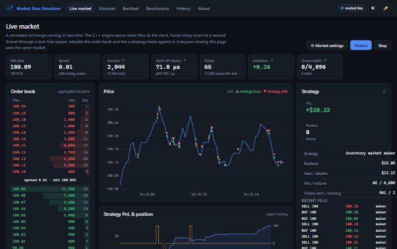

# Market Data Simulator

[](https://github.com/vnsiddhanth/market-data-simulator/actions/workflows/ci.yml)

**C++17 · lock-free multi-threading · limit order book · event-driven backtesting · Redis time-series · Python tooling**

A self-contained market microstructure lab **with a real-time web app**. It
generates realistic exchange order flow, moves it across threads through a
wait-free single-producer / single-consumer ring buffer, rebuilds a
price-time-priority limit order book, lets strategies paper-trade against it
live, persists analytics series and a lossless event log to Redis, and replays
it all through an event-driven backtester whose fill model tracks FIFO queue
position exactly.



## Try it in one command

```bash
docker build -t mds-web . && docker run --rm -p 8080:8080 mds-web
```

Open **http://localhost:8080**. The live market starts immediately. From
the browser you can also run simulations, backtests and benchmarks, browse
their history and download every output. See [docs/WEB_APP.md](docs/WEB_APP.md)
for a tour and [docs/DEPLOYMENT.md](docs/DEPLOYMENT.md) to host it (Docker
Compose with Redis, Render, Fly.io, any container platform or a VM).

> **New here?** [docs/GETTING_STARTED.md](docs/GETTING_STARTED.md) explains what
> the app does in plain language, every input and output, and step-by-step
> setup for Windows (WSL), Linux and macOS. Without Docker:
>
> ```bash
> git clone https://github.com/vnsiddhanth/market-data-simulator.git && cd market-data-simulator
> cmake -S . -B build -DCMAKE_BUILD_TYPE=Release && cmake --build build --parallel
> cd web && python3 -m mds_web          # web app on http://127.0.0.1:8080
> ```
>
> or `./demo.sh` for a command-line tour.

```
 SyntheticFeed ──► SpscRing<Envelope> ──► OrderBook ──► TickStore ──► Redis
  (Poisson flow,     (lock-free,            (std::map     (RedisTimeSeries
   shadow exchange)   cache-line padded)     + std::deque) + binary chunks)
                                                │                │
                                                ▼                ▼
                                          Backtester ◄──── load_events()
                                    (latency, queue position, fees, PnL)
```

| Component | Highlights |
|---|---|
| **Order book** ([docs](docs/ORDER_BOOK.md)) | `std::map` price levels (O(1) best bid/ask), `std::deque` FIFO queues, O(1) hash lookup by id, **lazy tombstone cancels** with amortised compaction, size-down keeps priority / size-up loses it, verified against a brute-force reference model on 20k random operations |
| **Lock-free pipeline** ([docs](docs/LOCK_FREE_PIPELINE.md)) | Wait-free SPSC ring: one acquire-load + one release-store per message, **no CAS / no lock prefix**, producer & consumer state on separate cache lines (+ adjacent-line prefetch padding), **cached remote indices**, batch publish; same pipeline templated over a mutex queue for a like-for-like benchmark |
| **Backtester** ([docs](docs/BACKTESTING.md)) | Event-driven, order-entry latency, **exact queue-position tracking** (uses each resting order's arrival sequence to know which cancels were ahead of you), trade-through fills, maker rebates / taker fees, Sharpe / Sortino / drawdown, two reference strategies |
| **Redis storage** ([docs](docs/REDIS_STORAGE.md)) | Dependency-free RESP2 client with pipelining, RedisTimeSeries series with labels + `DUPLICATE_POLICY`, server-side `AGGREGATION` bars, **lossless 40-byte binary event chunks** for exact replay, automatic **sorted-set fallback** on vanilla Redis, Cluster-safe `{hash-tag}` keys |
| **Web app** ([docs](docs/WEB_APP.md)) | Real-time engine `mds_live` (wall-clock-paced feed → SPSC ring → book + live paper trading) streamed to browsers over Server-Sent Events; stdlib-only Python backend with a validated job API, history and downloads; dependency-free frontend with canvas charts; one Docker image, health checks, optional access token, strict CSP |
| **Python** ([docs](python/README.md)) | Stdlib-only RESP client, byte-compatible event codec, reference order book, backtest analytics (mark-outs, cross-check of C++ metrics), an **in-repo fake Redis server** so the whole Redis path is testable without a server |

---

## Quick start

```bash
cmake -S . -B build -DCMAKE_BUILD_TYPE=Release
```

```bash
cmake --build build --parallel
```

```bash
ctest --test-dir build --output-on-failure
```

Run the pipeline (generates 1M events, runs them through both queue types and
verifies the rebuilt book matches the exchange's book level-for-level):

```bash
./build/mds_sim --events 1000000 --queue both
```

Backtest the two reference strategies (create the output folder first with `mkdir out`):

```bash
./build/mds_backtest --strategy mm --events 2000000 --report out/mm.json --equity out/mm_equity.csv --fills out/mm_fills.csv
```

```bash
./build/mds_backtest --strategy obi --events 2000000 --latency-us 100
```

Full Redis round trip (Redis Stack provides the RedisTimeSeries module):

```bash
docker compose -f docker/docker-compose.yml up -d
```

```bash
./build/mds_sim --events 500000 --queue spsc --redis 127.0.0.1:6379 --symbol SIM --purge
```

```bash
./build/mds_query --redis 127.0.0.1:6379 --symbol SIM --field mid --agg avg --bucket-ms 1000
```

```bash
./build/mds_backtest --strategy mm --redis 127.0.0.1:6379 --symbol SIM
```

No Docker? The in-repo fake Redis speaks enough RESP for every command used:

```bash
python python/scripts/fake_redis.py --port 6399
```

See [docs/BUILDING.md](docs/BUILDING.md) for compilers, sanitizers and Windows notes.

---

## Performance

Measured on an Intel Core i5-1235U (6 cores / 12 threads, laptop), Ubuntu on
WSL2, GCC 15.2 `-O3`, producer/consumer pinned to CPUs 2 and 4, median of 5
runs. Raw output of the latest run: [docs/BENCHMARK_RESULTS.md](docs/BENCHMARK_RESULTS.md).
Speed-ups are given as the range over three separate benchmark sessions.

| Benchmark | Lock-free SPSC | Mutex ring | Speed-up (3 sessions) |
|---|---:|---:|---:|
| Raw queue, pop 1 (20M × 48 B msgs) | 62.5 M msg/s | 6.25 M msg/s | **8.1× - 10.0×** |
| Raw queue, pop batch 64 | 189 M msg/s | 3.48 M msg/s | 54× - 60× |
| Pipeline feed → queue → book, batch 1 (2M events) | 7.74 M ev/s | 2.08 M ev/s | **3.7× - 4.2×** |
| Pipeline feed → queue → book, batch 64 | 11.1 M ev/s | 9.02 M ev/s | 1.15× - 1.34× |

| Single-threaded | Result |
|---|---|
| Order book `apply()` on realistic flow (60% add / 32% cancel / 3% modify / 5% market) | **15.3 M events/s**; p50 79-107 ns per op incl. timer overhead |
| Backtester, market maker, 2M events | **8.1 M events/s** |
| Backtester, imbalance taker, 2M events | **8.3 M events/s** |

### Strategy results (default feed, 2M events ≈ 1 000 simulated seconds)

| | Market maker | Imbalance taker |
|---|---:|---:|
| Total PnL | +$912 | −$13 915 |
| of which trading (realized) | −$142 | −$11 922 |
| of which fees / rebates | +$1 054 rebates | −$1 993 fees |
| 1 s mark-out per share | −$0.0002 | −$0.0178 |
| Max drawdown | $141 over 166 s | $13 915 |
| Interval win rate | 76% | 5% |

The market maker loses slightly on trading because informed flow and price
impact adversely select its quotes; its profit is the maker rebate, which is
how real rebate-driven market making looks. The imbalance taker has no edge in
this market and pays spread, fees and latency on every round trip. Both
results are explained by the fill model rather than by artefacts of it; see
[docs/BACKTESTING.md](docs/BACKTESTING.md#7-synthetic-market-realism).
Annualised Sharpe ratios are printed too, but annualising one-second PnL
steps from 17 simulated minutes gives very large magnitudes, so they are not
quoted here.

How to read these:

* The lock-free win is largest where the queue *is* the cost (raw transfer,
  single-item hand-off). With 64-event batches the mutex is taken once per
  batch and the order book dominates, so the end-to-end gap shrinks to 1.15-1.34×.
  Both are reported deliberately.
* Pipeline latency is printed by `bench_queue` but in replay mode the
  producer outruns the consumer and fills the 64K ring, so those figures are
  queueing backlog, not per-hop latency.
* ThreadSanitizer reports no races across the ring, mutex-queue and pipeline
  stress tests.

Reproduce (writes machine info and raw output to `docs/BENCHMARK_RESULTS.md`):

```bash
python python/scripts/run_benchmarks.py --build build --pin 2,4 --out docs/BENCHMARK_RESULTS.md
```

Methodology and tuning knobs are in [docs/PERFORMANCE.md](docs/PERFORMANCE.md).

---

## Repository layout

```
include/mds/
  common/        types (fixed-point prices), MarketEvent (40-byte POD), clock, affinity, stats, CLI
  orderbook/     OrderBook
  pipeline/      SpscRing, MutexQueue, MarketDataPipeline<Queue>
  feed/          SyntheticFeed + CSV / binary persistence
  backtest/      Backtester, Strategy API, Portfolio, metrics
  strategies/    InventoryMarketMaker, ImbalanceTaker
  storage/       RESP codec, RedisClient, TickStore
src/             implementations
apps/            mds_sim, mds_backtest, mds_query, mds_live (real-time engine)
bench/           bench_queue, bench_orderbook
tests/           C++ unit / property / concurrency tests (self-contained framework)
python/mds/      codec, resp, store, book, analysis
python/scripts/  fake_redis, ingest_events, redis_inspect, verify_events, analyze_backtest, run_benchmarks
web/mds_web/     web backend: HTTP API, job runner, live SSE stream (stdlib only)
web/frontend/    single-page app: live dashboard, simulate, backtest, benchmarks, history
web/tests/       backend end-to-end tests
Dockerfile       production image (engines + backend + frontend); compose.yaml adds Redis
docs/            getting started, architecture and technical notes
demo.sh          end-to-end demo (simulate -> Redis -> backtest -> analyse)
docker/          Redis Stack compose file, reproducible build image
```

## Documentation

| Document | Contents |
|---|---|
| [WEB_APP.md](docs/WEB_APP.md) | The web app: pages, how the real-time stream works, REST/SSE API |
| [DEPLOYMENT.md](docs/DEPLOYMENT.md) | Docker, Compose with Redis, Render, Fly.io, VMs, configuration, security, operations |
| [GETTING_STARTED.md](docs/GETTING_STARTED.md) | What the app is, inputs and outputs, step-by-step setup and usage, troubleshooting |
| [ARCHITECTURE.md](docs/ARCHITECTURE.md) | System overview, threading model, data flow, component contracts |
| [ORDER_BOOK.md](docs/ORDER_BOOK.md) | Data structures, matching algorithm, lazy cancellation, invariants, complexity |
| [LOCK_FREE_PIPELINE.md](docs/LOCK_FREE_PIPELINE.md) | SPSC ring design, C++ memory model argument, false sharing, why it beats a mutex |
| [BACKTESTING.md](docs/BACKTESTING.md) | Event loop, latency model, queue-position fill model, metrics formulas, known biases |
| [REDIS_STORAGE.md](docs/REDIS_STORAGE.md) | Key schema, down-sampling rules, chunked event log, pipelining, fallback mode |
| [PERFORMANCE.md](docs/PERFORMANCE.md) | Benchmark methodology, tuning knobs, interpreting results |
| [TECHNICAL_NOTES.md](docs/TECHNICAL_NOTES.md) | Design decisions and trade-offs (ADR style), limitations, roadmap, FAQ |
| [BUILDING.md](docs/BUILDING.md) | Toolchains, CMake options, sanitizers, CI |

## Testing

* **C++** (`mds_tests`, registered with CTest per suite): order-book unit tests,
  a **differential test against a brute-force reference book** (fills and depth
  compared after every one of 20 000 random operations), SPSC FIFO/full/empty/
  wrap-around tests, **two-thread stress tests** on tiny rings with sequence and
  checksum validation, pipeline consistency (downstream book == exchange book),
  scripted fill-model scenarios (queue position, cancels ahead, trade-through,
  latency), portfolio accounting identities, RESP codec byte-level tests.
* **Sanitizers**: CI runs the suite under AddressSanitizer and ThreadSanitizer.
* **Python** (`cd python && python -m unittest discover -s tests`): codec layout
  vs the C++ struct, reference book, analytics, and Redis round-trips over real
  TCP against the fake server in both RedisTimeSeries and fallback modes.

## License

MIT - see [LICENSE](LICENSE).
