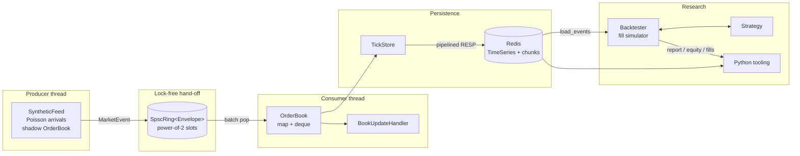
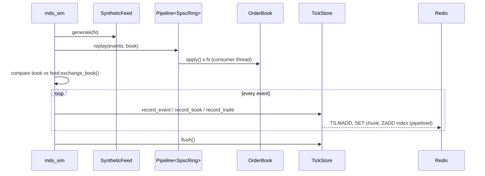
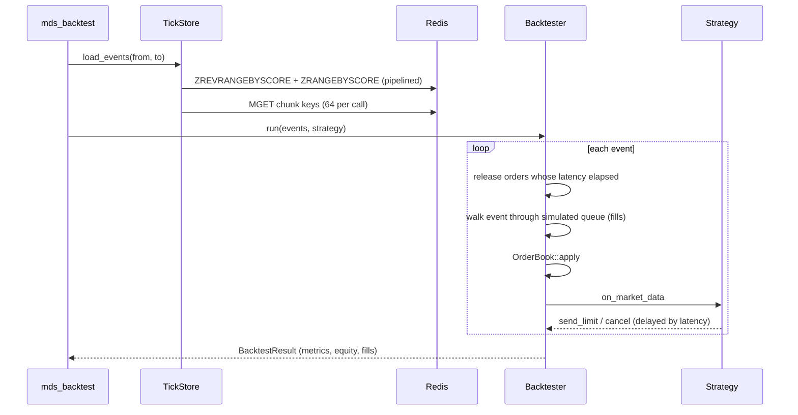

# Architecture

## 1. Goals

1. Model limit-order-book dynamics faithfully enough that a backtest's fills
   are believable (price-time priority, partial fills, queue position).
2. Move market data between threads with the lowest achievable overhead and
   *prove* the gain with a like-for-like benchmark.
3. Persist data in a form that serves two very different readers: analysts
   who want down-sampled, aggregated series, and the backtester which needs a
   lossless, ordered event stream.
4. Stay dependency-light: a C++17 compiler, CMake and (optionally) Redis.

## 2. Component map



| Layer | Header | Responsibility | Thread-safety |
|---|---|---|---|
| Vocabulary | `common/types.hpp`, `common/event.hpp` | Fixed-point `Price`, 40-byte `MarketEvent` POD | Immutable values |
| Order book | `orderbook/order_book.hpp` | Matching, depth, imbalance, invariants | Single-threaded by design (owned by one thread) |
| Transport | `pipeline/spsc_ring.hpp`, `mutex_queue.hpp` | Bounded FIFO between exactly two threads | SPSC contract |
| Pipeline | `pipeline/pipeline.hpp` | Producer/consumer orchestration, latency sampling | Owns its two threads |
| Feed | `feed/synthetic_feed.hpp` | Deterministic order-flow generation, CSV/binary I/O | Single-threaded |
| Storage | `storage/*.hpp` | RESP codec, socket client, schema | One client per thread |
| Backtest | `backtest/*.hpp` | Event loop, simulated exchange, accounting, metrics | Single-threaded, deterministic |

## 3. Threading model

The hot path has exactly **two threads and one shared object**: the ring.

```
producer:  generate/decode ─► stamp (1/64) ─► try_push ─(full?)─► backoff
                                                    │
                                    release-store tail_
                                                    ▼
consumer:  try_pop_n(64) ─(empty?)─► backoff     acquire-load tail_
              │
              ▼
           for each event: OrderBook::apply ─► handler ─► latency sample
```

Why only two threads?

* **The order book is inherently sequential** - event *n+1* may match against
  the order added by event *n*. Parallelising one instrument's book buys
  nothing but locks. Scale-out is per instrument (one pipeline per symbol or
  symbol shard), which is how real feed handlers are deployed.
* **SPSC is the strongest contract a queue can exploit.** With one writer per
  index, neither side needs a read-modify-write instruction. Any MPMC design
  pays for generality the system doesn't need.
* **Ownership instead of sharing.** The `OrderBook` is touched only by the
  consumer thread, so it needs no synchronisation at all. The only data that
  crosses cores is the 48-byte envelope and two counters.

Waiting uses bounded exponential back-off (`Backoff`): spin with `PAUSE` up to
64 iterations per round (sub-microsecond wake-up), then `yield()` so an
oversubscribed machine (CI, laptops) does not live-lock. Pinning
(`--pin P,C`) is optional and best-effort.

### Shutdown protocol

The producer sets `producer_done` with a **release** store after its final
push. The consumer, on finding the ring empty, does an **acquire** load of the
flag and, if set, **pops once more** before exiting. The release/acquire pair
guarantees every push that happened-before the flag store is visible to that
final pop, so no message can be stranded.

## 4. Data model

### Prices

`Price` is `int64` with 4 implied decimals (`kPriceScale = 10'000`). Using
`double` as a `std::map` key would make level identity depend on rounding
(0.1 + 0.2 ≠ 0.3), and integer comparison is cheaper. Conversion to `double`
happens only at I/O boundaries.

### MarketEvent (wire format)

| Offset | Field | Type | Notes |
|---:|---|---|---|
| 0 | `ts` | int64 | ns since epoch |
| 8 | `id` | uint64 | order id |
| 16 | `price` | int64 | fixed point; 0 for cancel/modify/market |
| 24 | `qty` | int64 | size, or new size for modify |
| 32 | `symbol` | uint32 | |
| 36 | `type` | uint8 | Add, Cancel, Modify, Market |
| 37 | `side` | uint8 | Buy, Sell |
| 38 | `flags` | uint16 | reserved (makes padding explicit) |

`static_assert`s pin the size (40) and trivially-copyable / standard-layout
properties, so the same bytes are valid in the ring, in a `.bin` file, in a
Redis chunk and in Python (`struct "<qQqqIBBH"`). The format assumes a
little-endian host (x86-64, AArch64).

## 5. End-to-end flows

### Simulate → persist



### Load → backtest



## 6. Determinism

Every run is reproducible bit-for-bit given a seed:

* `SyntheticFeed` uses `std::mt19937_64` and standard distributions.
* The backtester iterates its order map through a *sorted* id list wherever
  ordering affects results (`unordered_map` iteration order is unspecified).
* Floating point is only used for reporting and for the latent fair-value
  process (whose output is quantised to ticks).

The only non-deterministic outputs are wall-clock throughput/latency figures.

## 7. Error handling

* Book operations return `BookResult` and count rejects; they never throw on
  the hot path.
* I/O (files, sockets) throws `std::runtime_error` / `RedisError`; the apps
  catch at `main` and exit non-zero with a message.
* Redis error replies are returned as values (`RedisReply::Type::Error`) and
  converted to exceptions only where the caller cannot continue
  (`TickStore::check_replies`), with expected errors (e.g. "key already
  exists" from `TS.CREATE`) tolerated explicitly.

## 8. Extension points

| To add... | Implement / modify |
|---|---|
| A real feed (ITCH, FIX, CSV vendor) | A `Source` callable `bool(MarketEvent&)` passed to `MarketDataPipeline::run` |
| A strategy | Subclass `Strategy`; register a name in `make_strategy` |
| A new analytics series | Add a field to `TickStore::kFields`, emit it in `emit_snapshot` |
| Multiple instruments | One pipeline + book per symbol; `symbol` already travels in every event |
| A different queue | Any type with `try_push`, `try_pop_n`, `static name()` plugs into `MarketDataPipeline<Q>` |
