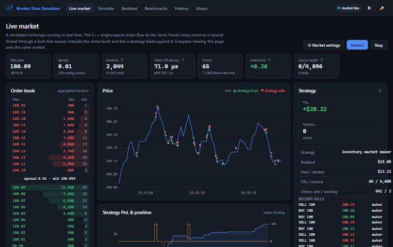
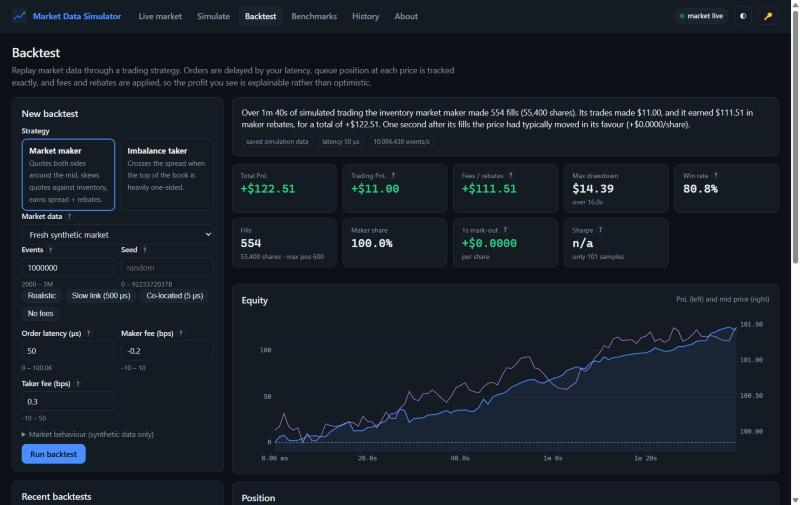

# Web app

The web app turns the simulator into a product you can open in a browser:
a **live market** running in real time, plus pages to run simulations,
backtests and benchmarks, keep their history and download every output.



## Pages

| Page | What you can do |
|---|---|
| **Live market** | Watch a simulated exchange in real time: order book ladder, price chart with the strategy's trades marked, trade tape, events/s, thread hand-off latency, queue depth, and the strategy's live PnL and position. Change the market (presets: Realistic, Calm, Volatile, Toxic flow, Noise only), the strategy, speed and latency, then restart. Everyone sees the same market. |
| **Simulate** | Run a batch through the lock-free and mutex pipelines; see throughput, speed-up, latency percentiles, the final book depth and the exact-match check. Save the events and backtest on them with one click. |
| **Backtest** | Choose a strategy (market maker or imbalance taker), fresh synthetic data or a saved simulation, latency and fees. Results include a plain-English explanation, PnL split into trading vs fees/rebates, drawdown, win rate, mark-outs, an equity curve against the price, position over time and a fills table. |
| **Benchmarks** | Measure the queue and the order book on the server itself (the live market pauses meanwhile): raw and end-to-end speed-ups plus per-operation latency. |
| **History** | Every run with status, summary and duration; open, cancel or delete. |
| **About** | What the app is, how it works, and this server's status. |



## How it works

```
 Browser (single-page app, no build step)
   │  fetch /api/...            EventSource /api/live/stream
   ▼                                    ▲
 Python backend (stdlib http.server)    │ Server-Sent Events: hello, history, tick, status
   ├── JobManager ── subprocess ──► mds_sim / mds_backtest / bench_*   (JSON outputs)
   └── LiveManager ─ subprocess ──► mds_live  ──stdout JSON Lines──┘
                                     │
                     feed thread ──SPSC ring──► book + strategy thread
```

* **The C++ engines do the work.** The backend validates requests, starts
  engines as subprocesses (argument lists, never a shell), and reads their
  JSON output.
* **Real time.** `mds_live` paces the synthetic exchange to the wall clock.
  Every event is stamped and passed through the lock-free ring, and the
  consumer thread rebuilds the book and runs the strategy through the same
  fill model as the backtester (the backtester's incremental
  `begin/step/finish` API). Several times a second it prints one JSON
  snapshot. The backend fans each snapshot out to every viewer over SSE,
  with a bounded queue per client so a slow browser can't hold up others.
  New viewers get recent history immediately.
* **Real latency.** Because events arrive at their natural pace, the
  "hand-off latency" on the Live page is the genuine time from enqueue on
  one thread to the book being updated on the other. When the market is
  idle the consumer thread sleeps instead of spinning, so an idle server
  uses almost no CPU.
* **Jobs.** Batch runs queue behind a worker pool (one worker by default,
  so benchmarks don't disturb each other). Each run has its own folder
  with `job.json`, the engine outputs and a log. Runs survive restarts;
  anything interrupted is marked as such.
* **No third-party dependencies.** The backend is Python standard library
  only, and the frontend is plain JavaScript modules with canvas charts.
  Nothing to `pip install` or `npm install`, and nothing to patch.

## API

All responses are JSON. Changes need `Authorization: Bearer <token>` when
the server sets `MDS_API_TOKEN`.

| Method & path | Body / query | Returns |
|---|---|---|
| `GET /api/health` | | `{"status": "ok"}` or 503 |
| `GET /api/info` | | version, limits, parameter schemas (defaults, ranges, choices), Redis/live/job status |
| `GET /api/live` | | live market status and parameters |
| `POST /api/live/start` | `{"params": {strategy, rate, speed, vol, informed, impact, latency_us, snapshot_ms, seed}}` | status; (re)starts the market |
| `POST /api/live/stop` | | status |
| `GET /api/live/stream` | | `text/event-stream` with `status`, `hello`, `history` and `tick` events |
| `GET /api/jobs` | `?kind=simulation\|backtest\|benchmark` | recent jobs (without full results) |
| `POST /api/jobs` | `{"kind": "...", "params": {...}}` | 202 + job; 422 with per-field `details` on invalid input |
| `GET /api/jobs/<id>` | | job including full `result` |
| `DELETE /api/jobs/<id>` | | cancels an active job, otherwise deletes it |
| `GET /api/jobs/<id>/files/<name>` | | download: `summary.json`, `report.json`, `equity.csv`, `fills.csv`, `ticks.bin`, `bench_*.json`, `log.txt` |

Example: start a backtest with curl.

```bash
curl -X POST localhost:8080/api/jobs -H 'Content-Type: application/json' -d '{"kind":"backtest","params":{"strategy":"mm","events":1000000,"latency_us":100}}'
```

## Tests

```bash
cd web && python3 -m unittest discover -s tests -v
```

The suite starts the real server in-process. It covers:
- validation, auth, static serving and SPA fallback, ETag caching;
- security headers, path traversal and job-id safety;
- with the engines built: a simulation → backtest-on-its-data → download
  flow, cancel/delete, and the live stream delivering ticks.

CI also builds the Docker image, runs the container and checks health, the
live stream, auth and a job running inside it.

See [DEPLOYMENT.md](DEPLOYMENT.md) to run it with Docker or host it in the cloud.
